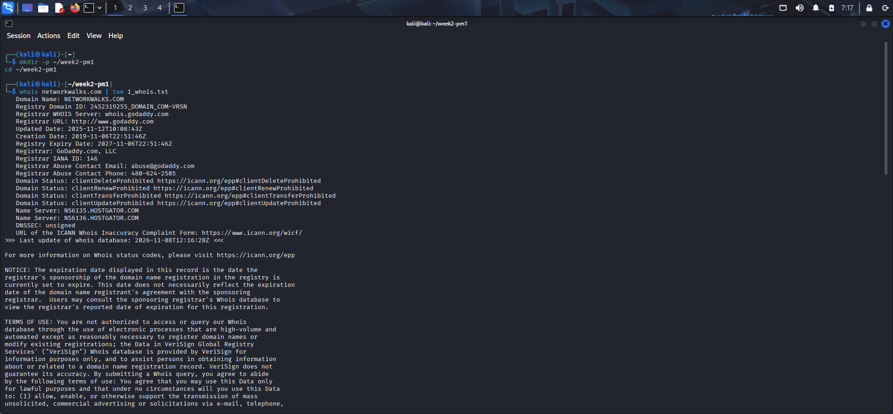
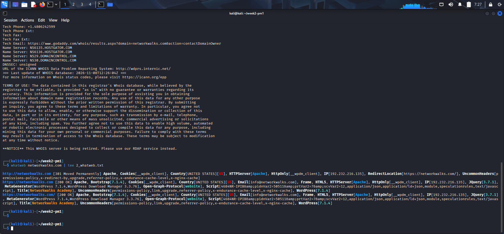
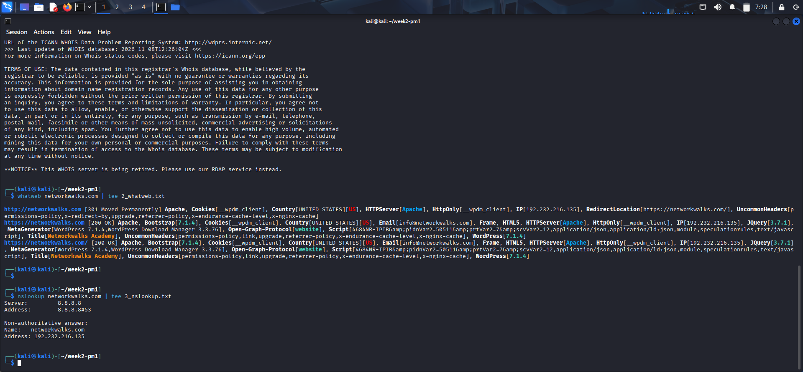
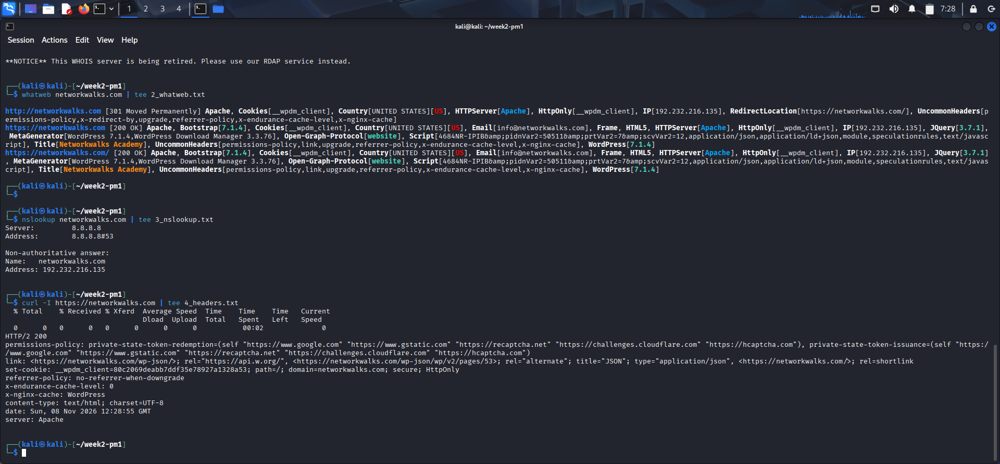
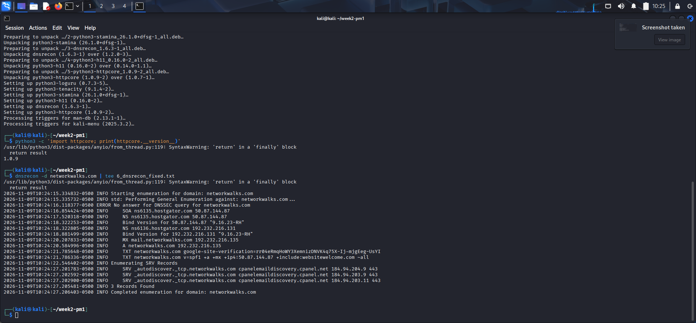

# -Penetration-Testing-Footprinting-Network-Scanning

# Penetration Testing Report: Footprinting & Network Scanning

> **Disclaimer:** This work was done for an authorised training lab as part of the Networkwalks cybersecurity course. It is for educational purposes only. No exploitation was attempted. Do not scan systems or networks without permission.

| | |
|---|---|
| **Prepared by** | Kelechi Happiness Uzoma |
| **Batch** | B084C |
| **Instructor** | Waqas Karim |
| **Target (footprinting)** | networkwalks.com |
| **Target (network scanning)** | 192.168.1.0/24 (local network) |
| **Testing dates** | 8–9 November 2026 |
| **Testing platforms** | Kali Linux (footprinting); Windows with Zenmap / Nmap 7.98 (scanning) |
| **Report version** | 1.0 |

## Contents

1. [Executive Summary](#1-executive-summary)
2. [Scope and Authorisation](#2-scope-and-authorisation)
3. [Methodology and Tools](#3-methodology-and-tools)
4. [Phase 1 – Footprinting Results](#4-phase-1--footprinting-results)
5. [Phase 2 – Network Scanning Results](#5-phase-2--network-scanning-results)
6. [Summary of Findings](#6-summary-of-findings)
7. [Recommendations](#7-recommendations)
8. [Conclusion](#8-conclusion)

---

## 1. Executive Summary

This report covers the first two phases of a penetration test: footprinting of the domain networkwalks.com, and network scanning of the local network 192.168.1.0/24. No exploitation was attempted.

Key results:

- The domain resolves to one IP address, **192.232.216.135**, on HostGator shared cPanel hosting. The same address serves web and mail.
- The website runs **WordPress 7.1.4** on **Apache** with the **WordPress Download Manager 3.3.76** plugin. Both versions are publicly disclosed.
- The site is protected by a **ModSecurity (SpiderLabs) WAF** and enforces HTTPS by redirect.
- The name servers disclose their **BIND version (9.16.23-RH)**. **DNSSEC is not enabled**, and the **SPF policy ends in a soft fail (~all)**.
- Several recommended **HTTP security headers were not present** in the server response.
- The network scan found **7 hosts up**: the scanning machine and six other devices. Four hosts have open ports.
- The gateway router (192.168.1.1) exposes **SMB file sharing (ports 139 and 445)** and an **unencrypted HTTP admin page** to the whole LAN.

**Overall risk rating: Low for the public website; Low to Medium for the internal network**, pending service version checks. No directly exploitable weakness was confirmed. The findings are information disclosure, hardening gaps and unnecessary exposed services.

---

## 2. Scope and Authorisation

| Item | Detail |
|---|---|
| In scope | Public information about networkwalks.com; host discovery and port scanning of 192.168.1.0/24 |
| Out of scope | Exploitation, brute forcing, denial of service, social engineering |
| Authorisation | Performed as part of the Networkwalks cybersecurity course lab |
| Scanner IP | 192.168.1.12 (inferred from the scan) |

---

## 3. Methodology and Tools

| Phase | Tool | Purpose | Output file |
|---|---|---|---|
| Footprinting | whois | Domain registration details | 1_whois.txt |
| Footprinting | WhatWeb | Web technology fingerprinting | 2_whatweb.txt |
| Footprinting | nslookup | DNS resolution | 3_nslookup.txt |
| Footprinting | curl -I | HTTP response header analysis | 4_headers.txt |
| Footprinting | wafw00f v2.3.1 | WAF detection | 5_waf.txt |
| Footprinting | dnsrecon 1.6.3 | DNS record enumeration | 6_dnsrecon_fixed.txt |
| Scanning | Zenmap (Nmap 7.98) | Host discovery, port scan, topology | Zenmap screenshots |

Footprinting output was saved to `~/week2-pm1` using `tee`.

---

## 4. Phase 1 – Footprinting Results

### 4.1 WHOIS Lookup

**Command:** `whois networkwalks.com | tee 1_whois.txt`

| Field | Value |
|---|---|
| Domain name | NETWORKWALKS.COM |
| Registry Domain ID | 2452319255_DOMAIN_COM-VRSN |
| Registrar | GoDaddy.com, LLC (IANA ID 146) |
| Creation date | 2019-11-06 |
| Updated date | 2025-11-12 |
| Expiry date | 2027-11-06 |
| Domain status | clientDeleteProhibited, clientRenewProhibited, clientTransferProhibited, clientUpdateProhibited |
| Name servers (registry) | NS6135.HOSTGATOR.COM, NS6136.HOSTGATOR.COM |
| Name servers (registrar record) | The two above, plus NS29.DOMAINCONTROL.COM and NS30.DOMAINCONTROL.COM |
| DNSSEC | Unsigned |

**Analysis:**

- The domain is registered with GoDaddy, but DNS is delegated to HostGator.
- All four client lock statuses are set, which protects against unauthorised transfer or deletion.
- Registrant contact details are hidden behind GoDaddy's contact form, which limits material for social engineering.
- The registrar record lists two extra GoDaddy name servers that the registry does not. This looks like a stale entry.

### 4.2 Web Technology Fingerprinting (WhatWeb)

**Command:** `whatweb networkwalks.com | tee 2_whatweb.txt`

| Item | Result |
|---|---|
| HTTP response | 301 Moved Permanently to https://networkwalks.com/ |
| HTTPS response | 200 OK |
| IP address / country | 192.232.216.135 / United States |
| Web server | Apache (version not disclosed) |
| CMS | WordPress 7.1.4 (from the meta generator tag) |
| Plugin | WordPress Download Manager 3.3.76 |
| JavaScript library | jQuery 3.7.1 |
| Page title | Networkwalks Academy |
| Email found | info@networkwalks.com |
| Cookie | __wpdm_client (HttpOnly) |
| Uncommon headers | permissions-policy, link, upgrade, referrer-policy, x-endurance-cache-level, x-nginx-cache, x-redirect-by |

**Analysis:**

- The exact WordPress and plugin versions are exposed, so an attacker can match them against public vulnerability databases.
- WhatWeb also reported "Bootstrap 7.1.4". This is most likely a false positive taken from the WordPress version string, because the number is identical.
- The `x-endurance-cache-level` and `x-nginx-cache` headers show a caching layer typical of HostGator-family hosting.

### 4.3 DNS Resolution (nslookup)

**Command:** `nslookup networkwalks.com | tee 3_nslookup.txt`

| Field | Value |
|---|---|
| Resolver used | 8.8.8.8#53 (Google Public DNS) |
| Answer type | Non-authoritative |
| A record | networkwalks.com → 192.232.216.135 |

**Analysis:** The domain resolves to a single IPv4 address with no load balancing or CDN in front of it. The origin server's real IP is therefore directly exposed.

### 4.4 HTTP Header Analysis (curl)

**Command:** `curl -I https://networkwalks.com | tee 4_headers.txt`

| Header | Value |
|---|---|
| Status | HTTP/2 200 |
| server | Apache |
| content-type | text/html; charset=UTF-8 |
| set-cookie | __wpdm_client=[masked]; path=/; domain=networkwalks.com; secure; HttpOnly |
| referrer-policy | no-referrer-when-downgrade |
| permissions-policy | private-state-token-redemption / issuance rules present |
| link | https://networkwalks.com/wp-json/ (WordPress REST API) |
| x-nginx-cache | WordPress |
| x-endurance-cache-level | 0 |

**Analysis:**

- **Good:** HTTP/2 is supported, the cookie has the `Secure` and `HttpOnly` flags, and the Apache version is hidden.
- **Missing from the response:** `Strict-Transport-Security`, `Content-Security-Policy`, `X-Frame-Options` and `X-Content-Type-Options`. The cookie also has no `SameSite` attribute.
- The `link` header advertises the WordPress REST API (`/wp-json/`). This endpoint can sometimes be used to enumerate users. It was not tested in this phase.

### 4.5 WAF Detection (wafw00f)

**Command:** `wafw00f networkwalks.com | tee 5_waf.txt`

| Field | Value |
|---|---|
| Result | Site is behind **ModSecurity (SpiderLabs)** WAF |
| Requests sent | 2 |

**Analysis:** A WAF is active. This is a positive control. Later testing should expect filtering and blocking of malicious-looking requests.

### 4.6 DNS Enumeration (dnsrecon)

**Command:** `dnsrecon -d networkwalks.com | tee 6_dnsrecon_fixed.txt`

| Record | Name | Value |
|---|---|---|
| SOA | ns6135.hostgator.com | 50.87.144.87 |
| NS | ns6135.hostgator.com | 50.87.144.87 (BIND 9.16.23-RH) |
| NS | ns6136.hostgator.com | 192.232.216.131 (BIND 9.16.23-RH) |
| MX | mail.networkwalks.com | 192.232.216.135 |
| A | networkwalks.com | 192.232.216.135 |
| TXT | networkwalks.com | google-site-verification=[masked] |
| TXT (SPF) | networkwalks.com | v=spf1 +a +mx +ip4:50.87.144.87 +include:websitewelcome.com ~all |
| SRV | _autodiscover._tcp.networkwalks.com | cpanelemaildiscovery.cpanel.net:443 |
| DNSSEC | – | No answer (not configured) |

**Analysis:**

- Both name servers reveal their BIND version.
- Web and mail share one IP address, so a compromise or outage of that server affects both services.
- The SPF record ends in `~all` (soft fail), so spoofed mail is flagged rather than rejected.
- No DMARC record appeared in the output. This was not checked directly.
- The SRV records confirm the mail service is cPanel-based.

**Tool note:** The first dnsrecon run failed. The tool was upgraded to 1.6.3 with python3-httpcore 1.0.9, and the scan then completed.

---

## 5. Phase 2 – Network Scanning Results

### 5.1 Scan Details

| Item | Detail |
|---|---|
| Tool | Zenmap (Nmap 7.98) on Windows |
| Profile | Quick scan |
| Command | `nmap -T4 -F 192.168.1.0/24` |
| Started | 2026-11-09 13:35 (+01:00) |
| Result | 256 IP addresses scanned, **7 hosts up**, completed in 8.56 seconds |

`-T4` sets aggressive timing. `-F` (fast mode) scans only the 100 most common TCP ports.

### 5.2 Host and Port Results

MAC addresses are partly masked for privacy.

| Host | MAC address (vendor) | Other ports | Open ports (service) | Likely role |
|---|---|---|---|---|
| 192.168.1.1 | 8C:18:50:XX:XX:XX (China Mobile (Hangzhou) Information Technology) | 96 closed | 53 (domain), 80 (http), 139 (netbios-ssn), 445 (microsoft-ds) | Gateway router |
| 192.168.1.2 | Randomised (vendor unknown) | 100 closed | None | Client device, probably a phone or tablet |
| 192.168.1.3 | Randomised (vendor unknown) | 100 closed | None | Client device, probably a phone or tablet |
| 192.168.1.6 | 48:4C:86:XX:XX:XX (Huawei Device) | 97 filtered | 53 (domain), 80 (http), 443 (https) | Huawei network device (router, modem or access point) |
| 192.168.1.8 | Randomised (vendor unknown) | 100 closed | None | Client device, probably a phone or tablet |
| 192.168.1.9 | DC:F5:1B:XX:XX:XX (Arcadyan) | 96 closed | 3000 (ppp), 8008 (http), 8009 (ajp13), 8443 (https-alt) | Probably a set-top box or smart TV device |
| 192.168.1.12 | Not shown | 97 closed | 135 (msrpc), 139 (netbios-ssn), 445 (microsoft-ds) | Windows PC, almost certainly the scanning machine |

### 5.3 Host Analysis

**192.168.1.1 – gateway router**

- Port 53 shows it is the LAN's DNS forwarder, and port 80 is its web admin page.
- The admin page uses plain HTTP, so the admin password can be sniffed by anyone on the LAN.
- Ports 139 and 445 mean SMB file sharing is running on the router, probably a USB storage sharing feature. Router SMB services are often outdated, so this is the most important internal finding.

**192.168.1.6 – Huawei device**

- 97 ports are filtered (no response), so a firewall is dropping packets.
- It offers DNS and a web interface on both HTTP and HTTPS. It behaves like a second router, modem or access point.

**192.168.1.9 – Arcadyan device**

- Ports 8008, 8009 and 8443 together are the usual pattern for a Google Cast device, such as a Chromecast, Android TV or ISP set-top box.
- Nmap labelled 8009 as "ajp13" and 3000 as "ppp" from the port numbers only. These labels are probably not accurate. The service on port 3000 is unidentified.

**192.168.1.12 – Windows PC**

- Ports 135, 139 and 445 are the standard Windows RPC and file sharing ports.
- Nmap shows no MAC address for this host, which normally means it is the machine running the scan.

**192.168.1.2, .3 and .8 – client devices**

- All 100 scanned ports are closed, so they offer no services on common ports.
- Their MAC addresses are locally administered (randomised), which is typical of phones and tablets using a private Wi-Fi address.

### 5.4 Topology Analysis

- All hosts connect directly to localhost. The network is a single flat subnet with no segmentation.
- Zenmap colours match the port counts: green nodes (.2, .3, .8) have no open ports, and yellow nodes (.1, .6, .9, .12) have three or four.
- No red nodes (more than six open ports) were seen.

### 5.5 Limitations

- Only the top 100 TCP ports were scanned. Other TCP ports and all UDP ports were not checked.
- No version detection (`-sV`) or OS detection (`-O`) was used. Service names are guesses based on port numbers, and device roles are inferred from MAC vendors and port patterns.
- Suggested follow-up: `nmap -sV -O 192.168.1.1,6,9,12`

---

## 6. Summary of Findings

| ID | Finding | Evidence | Risk |
|---|---|---|---|
| F-01 | WordPress and plugin versions disclosed | WhatWeb | Low |
| F-02 | Security headers missing (HSTS, CSP, X-Frame-Options, X-Content-Type-Options) | curl | Low |
| F-03 | SPF soft fail (~all); no DMARC record observed | dnsrecon | Low |
| F-04 | BIND version disclosed on name servers | dnsrecon | Low |
| F-05 | DNSSEC not enabled | whois, dnsrecon | Low |
| F-06 | WordPress REST API endpoint advertised | curl | Informational |
| F-07 | Web and mail on one shared-hosting IP; origin IP exposed | nslookup, dnsrecon | Informational |
| F-08 | Contact email publicly exposed | WhatWeb | Informational |
| F-09 | Name server mismatch between registry and registrar records | whois | Informational |
| F-10 | SMB (139, 445) exposed on gateway router 192.168.1.1 | Nmap | Medium (confirm SMB version) |
| F-11 | Router admin interfaces over unencrypted HTTP (192.168.1.1 and 192.168.1.6) | Nmap | Low |
| F-12 | Media device 192.168.1.9 exposes cast ports and an unidentified service on port 3000 | Nmap | Low |
| F-13 | Windows RPC and SMB ports open on 192.168.1.12 | Nmap | Low |
| F-14 | Flat network: every device can reach every other device | Zenmap topology | Low |

**Positive observations:** ModSecurity WAF is active, HTTP redirects to HTTPS, the cookie uses `Secure` and `HttpOnly`, domain lock statuses are enabled, the Apache version is hidden, 192.168.1.6 filters unused ports, and three client devices expose no services.

---

## 7. Recommendations

**Website (networkwalks.com)**

1. **Hide version information.** Remove the WordPress generator meta tag and plugin version strings. Keep the core, plugins and themes updated.
2. **Add security headers.** Configure `Strict-Transport-Security`, `Content-Security-Policy`, `X-Frame-Options` (or `frame-ancestors`), `X-Content-Type-Options: nosniff`, and `SameSite` on cookies.
3. **Strengthen email authentication.** Move SPF to `-all` once legitimate senders are confirmed. Publish a DMARC record and enable DKIM.
4. **Enable DNSSEC** if the hosting provider supports it.
5. **Restrict the REST API.** Block unauthenticated access to user endpoints such as `/wp-json/wp/v2/users`.
6. **Ask the hosting provider** to suppress the BIND version banner, or consider a managed DNS/CDN service that also hides the origin IP.
7. **Clean up the registrar name server records** so they match the registry delegation.

**Internal network (192.168.1.0/24)**

8. **Disable SMB on the router** if file sharing is not needed. If it is needed, require a password and disable SMBv1.
9. **Secure router administration.** Change default admin passwords, update firmware, and use HTTPS for the admin page where available.
10. **Identify the service on port 3000** of 192.168.1.9 and disable it if it is not required.
11. **Restrict Windows file sharing.** Set the network profile to Public on untrusted networks, or limit ports 135, 139 and 445 with Windows Firewall.
12. **Segment the network.** Put TV, IoT and guest devices on a separate guest network or VLAN.
13. **Run a deeper scan** with version and OS detection to confirm the device roles and service versions.

---

## 8. Conclusion

The footprinting phase built a clear profile of networkwalks.com from public sources: registrar, hosting provider, IP address, DNS records, mail setup, web technologies and WAF. The site has reasonable baseline protection, but it leaks version details and lacks several hardening measures.

The scanning phase found seven live hosts on 192.168.1.0/24, four of them with open ports. The main concern is SMB file sharing on the gateway router. These results are the input for the next phase, enumeration and vulnerability analysis.

---

## Author

**Kelechi Happiness Uzoma** – Cybersecurity student, Networkwalks Academy (Batch B084C)
